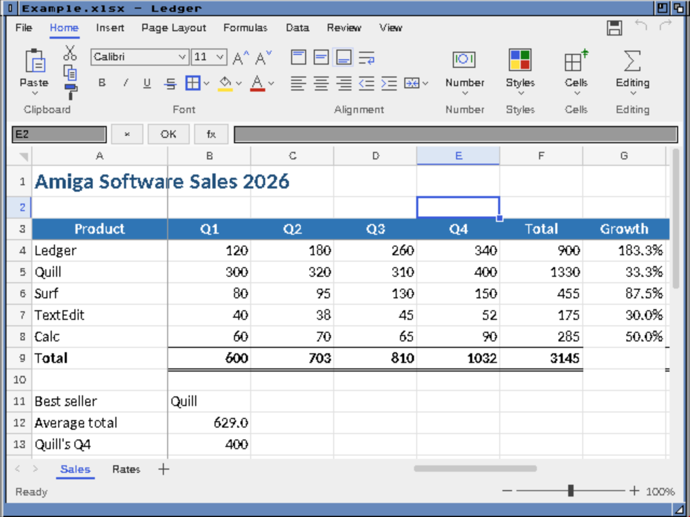

# Ledger: a spreadsheet for the Amiga

[](https://buymeacoffee.com/farsonic)

Ledger 0.3 is a native spreadsheet for AmigaOS with a MUI interface. It reads and writes Excel workbooks (.xlsx) and CSV files, opens old Excel (.xls) and OpenDocument (.ods) files, exports PDF, and works out formulas as Excel does, with 514 functions (every one GridCraft has), dynamic arrays and LAMBDA. It is written in C for a 68040 or better (it uses the 68040's floating-point unit). Its design and look follow GridCraft, an open-source spreadsheet in Rust, the way Quill, Ledger's word-processing sibling, follows WordCraft (see "Why C, not a port"). It shares Quill's ribbon, File page, dialogs, icons and screen fonts, so the two look and work alike.



## What it does

### Workbooks

- **Excel files:** reads and writes .xlsx: values, formulas (shared formulas included), several sheets, number formats, fonts, fills, borders, alignment, wrapping and indents, column widths and row heights, hidden rows and columns, merged cells, frozen panes, defined names, sheet tab colours, the workbook's title and author. Newer functions are written with Excel's `_xlfn.` prefix, so Excel and LibreOffice open them. Values are saved with the formulas, so other programs show results straight away.
- **CSV:** opens comma, semicolon or tab separated files (the separator is guessed), reading numbers and dates as typed. **Save Sheet as CSV** writes the sheet's values; **Import CSV** brings a file in as a new sheet.
- **Templates:** File > New offers a blank workbook and four ready to fill in: Budget, Invoice, Expenses (with totals by category) and Grades. Each is a working sheet with ordinary formulas.

### Formulas

- Formulas as Excel writes them: `=SUM(B2:B9)*(1+Tax)`, `'Other Sheet'!A1`, `$A$1`, whole columns `A:A` and rows `3:3`, array constants `{1,2;3,4}`, `&` for joining text, `%`, comparisons, and names.
- **Over 200 functions:** maths (SUM, ROUND, MOD, SUMPRODUCT...), statistics (AVERAGE, MEDIAN, STDEV, RANK, LARGE...), conditional (SUMIF(S), COUNTIF(S), AVERAGEIF(S), MAXIFS, MINIFS), logic (IF, IFS, IFERROR, SWITCH, AND, OR, XOR), text (LEFT, MID, FIND, SUBSTITUTE, TEXT, TEXTJOIN, CONCAT, PROPER...), lookup (VLOOKUP, HLOOKUP, XLOOKUP, INDEX, MATCH, OFFSET, INDIRECT, CHOOSE...), dates (DATE, TODAY, NOW, EDATE, EOMONTH, NETWORKDAYS, WORKDAY, DATEDIF, WEEKNUM, YEARFRAC...) and finance (PMT, FV, PV, NPER, RATE, IPMT, PPMT, NPV, IRR, SLN).
- **Dates:** Excel's 1900 date system, including its make-believe 29 February 1900, so serial numbers match Excel's. Dates typed as day/month/year (or month/day/year, set in File > Options).
- **Calculation:** formulas are worked out again after every change, only where needed. Circular references show 0 rather than hanging. Calculation can be set to manual (F9 or Calculate Now works it out).
- **Errors:** #DIV/0!, #N/A, #VALUE!, #REF!, #NAME? and the rest, as Excel gives them. Deleting rows or columns that formulas point at gives #REF!.

### The sheet

- **Cells** are drawn in their own fonts (Calibri shows as Carlito, its metric-compatible twin, Cambria as Caladea, Arial and Times as Liberation), with bold, italic, underline, strikethrough, colours, fills, borders (thin, medium, thick, double, dotted, dashed), alignment, vertical alignment, indents and wrapped text. Text runs on over empty cells, as in Excel; numbers too wide for their column show as `####`. Rows grow to fit big fonts.
- **Number formats:** General, number, currency, accounting, dates and times (including `[h]:mm` and AM/PM), percentages, fractions, scientific, text, colours (`[Red]`), conditions (`[>=1000]`) and custom codes with up to four sections.
- **Selecting:** click, drag, Shift-click, whole rows and columns from their headings, everything from the corner. Merged cells are selected whole.
- **Frozen panes:** rows and columns that stay in sight while the rest scrolls.
- **Zoom** from 10% to 400%.
- **Several sheets** with tabs at the bottom: add, delete, rename (double-click), duplicate, move, hide, unhide and colour them (right mouse button on a tab).
- **Several workbooks** at once, each in its own window.

### Editing

- **Typing:** type into a cell, or double-click or press F2 to change what's there. The formula bar shows the whole entry and can be typed in too. Missing closing brackets are put in for you.
- **Point mode:** while typing a formula, click a cell (or drag over a range), or use the arrow keys after an operator, and its reference is typed in.
- **The fill handle:** drag the small square at the corner of the selection to continue a series: numbers (1, 3, 5...), dates, `Item 1`, `Q1`, day and month names; formulas are copied with their references moved. Fill Down, Fill Right and Series... are in Home > Fill.
- **Copy and paste** within Ledger keeps formulas, values and formats (formulas pointing at the same cells relative to themselves). **Cut** moves cells. **Paste Values**, **Paste Formulas**, **Paste Formatting** and **Transpose** are on the Paste button's arrow. Text from other programs pastes as tab-separated cells, and copied cells go to the clipboard as text.
- **Undo and redo** for every change, as far back as 100 steps.
- **Insert and delete** rows, columns and cells (shifting the others), with formulas everywhere following.
- **Sort** by one column (A to Z, Z to A) or by up to three, keeping a heading row; formulas move with their rows. **Remove Duplicates** takes out repeated rows.
- **Find and Replace** in values or formulas, in one sheet or all of them, matching case or whole cells. **Go To** a cell, a range or a name.
- **AutoSum** (and Average, Count, Max, Min) over the numbers above or to the left; with several cells selected, totals go under each column.
- **Names:** the Name Box shows and takes addresses and names (type a new name there to name the selection); Define Name and the Name Manager list, add and delete them.
- **Format Painter**, **Cell Styles** (Good, Bad, Neutral, Title, Headings, Total, Input, Output, Calculation, Note, Accents) and the **Format Cells** window (number, alignment, font, border and fill on five pages).
- **Insert Function** lists the functions by category with a line about what each does.
- **Coloured references:** while you type a formula, each reference in it takes a colour of its own and the cells it points at are boxed in that colour (the one being pointed at with the mouse or arrow keys has a dashed box).

### Filters, conditional formatting, notes and links (new in 0.2)

- **AutoFilter** (Data > Filter): a button on each heading of the table round the active cell. A button lists the column's values with a tick each: untick some to hide their rows, or sort the table by that column from there. Filtered columns show a funnel on their button, and the row numbers of a filtered table turn blue. **Clear** shows every row again; **Reapply** filters again after the values change. The status bar's sums leave out hidden rows. Filters are saved in the workbook as Excel saves them.
- **Conditional formatting** (Home > Conditional Formatting): cells change their look by what they hold. Highlight rules for greater than, less than, between, equal to, text containing, duplicate or unique values, top or bottom ten (items or per cent) and above or below average, each with a preset look (light red fill with dark red text and so on) or your own fill, font colour, bold, italic, underline and strikethrough. **New Rule** adds the rest: text that doesn't contain, begins or ends with, blank and non-blank cells, errors, and a formula of your own (`=$B2>$C2`) whose references move from cell to cell. **Data bars** and two- and three-colour **colour scales** show values at a glance. **Manage Rules** lists the sheet's rules in order (the first wins where they disagree) to edit, delete or move up and down; **Clear Rules** takes them off the selection or the sheet. Rules are kept in the workbook and Excel and LibreOffice show them the same.
- **Notes** (Review > New Note, or the right mouse button): a few words on a cell, with its author. Cells with a note have a red corner; rest the mouse on one to read it, or **Show All Notes**. **Previous** and **Next** go from note to note. Notes move with their cells when rows are inserted, deleted or sorted, and are saved as Excel's notes.
- **Links** (Insert > Link): a cell can link to a web page, a mail address, or a cell on any sheet of the workbook, with a tip of its own. Rest the mouse on it to see where it goes; hold Ctrl and click it to follow it (web pages and mail open through openurl.library, which most Amiga browsers install). The **HYPERLINK** function makes links from formulas. Links are saved in the workbook.

## The window

As in GridCraft, from the top:

- **The ribbon:** File, Home, Insert, Page Layout, Formulas, Data, Review and View, with Save, Undo and Redo at the right of the tabs. Hover over any tool for its name, its shortcut and what it does. When the window is too narrow, tools lose their labels and then whole groups become one button that lists their tools.
  - **Home:** Clipboard; Font (font with previews, size, grow, shrink, bold, italic, underline, strikethrough, borders, fill and font colour); Alignment; Number (format, currency, percent, comma, decimals); Styles; Cells (insert, delete, format); Editing (AutoSum, Fill, Clear, Sort, Find & Select).
  - **Insert:** a new sheet, rows, columns, cells, a function, today's date, the time, symbols, a name.
  - **Page Layout:** gridlines, headings and zero values for the sheet; rename, tab colour, hide, unhide, duplicate, move and delete the sheet.
  - **Formulas:** Insert Function, AutoSum, the function library by category, the Name Manager, Show Formulas, Calculate Now and the calculation options.
  - **Data:** import a CSV, sort, Remove Duplicates, Fill.
  - **Review:** workbook statistics, find, replace and go to.
  - **View:** formula bar, gridlines and headings, zoom, zoom to selection, freeze panes, new window, switch windows, Dark Mode.
- **The formula bar:** the Name Box, Cancel, Enter, Insert Function, and the active cell's entry.
- **The grid**, with its scroll bars.
- **The sheet tabs** and the horizontal scroll bar.
- **The status bar:** Ready, Enter or Edit; Calculate when calculation is manual; the average, count and sum of the selected cells; and the zoom slider.
- **The File page** (the File tab): templates and recent workbooks, Open, Info (sheets, cells, formulas, names), Save, Save As, Export (Excel or CSV), Options (date order, light or dark theme, text size, your name) and About.
- **Menus** (right mouse button) have every command as well, with keyboard shortcuts.

## Setting up

1. Unpack the archive (`lha x Ledger-0.3.lha`). You get a **Ledger** drawer with its own icon. Open it and either:
   - **double-click Install-Ledger** (it needs Installer, which comes with Workbench 3.x and AROS). It asks where to put Ledger, makes a Ledger drawer there and copies everything with its icons. The example workbook and the source code are optional. Installing over an older Ledger updates it and keeps your settings. It can also remove an installed Ledger. If Workbench can't find Installer, select the Install-Ledger icon, choose **Icons > Information...** and set its Default Tool to where Installer is (`C:Installer`, `SYS:Utilities/Installer` or `SYS:System/Installer`). On AROS, start it from a Shell in the Ledger drawer instead: `Installer SCRIPT Install-Ledger APPNAME Ledger`;
   - or just use the drawer where it is, or drag it anywhere. Ledger needs `Ledger`, `Fonts` and `TrueType` kept together.

   Ledger keeps its options and recent workbooks in `Ledger.prefs` and `Ledger.recent` next to it. Every file has an icon: the drawers, Ledger, the installer, the README (shown with MultiView) and the example workbook (which opens in Ledger when double-clicked).
2. You need MUI 3.8 or later (MUI 5 for 68k, or AROS's Zune).
3. Start Ledger from a Shell, optionally with a workbook: `Ledger Work:Accounts.xlsx` (or a .csv).
   - `DEBUG=file` writes a trace of commands.
   - `PUBSCREEN=name` opens Ledger on that public screen (also as a tooltype in Ledger's icon).
4. A 68040 or 68060 with its FPU is needed. 16 MB or more of memory is comfortable; big workbooks want more.
5. Graphics: an RTG screen (Picasso96 or CyberGraphX) shows the cells best; AGA works too, on fewer colours.

### Bureau

Ledger is also part of **Bureau**, one package with Quill, Ledger, Easel, Folio and Dispatch and a single
installer (`Install-Bureau`), where the files the programs share are installed once: the screen fonts in
`FONTS:`, the TrueType fonts in `Bureau:TrueType`, the word lists in `Bureau:Dict`, and Ledger in
`Bureau:Ledger` with nothing else beside it. The installer assigns `Bureau:` in `S:User-Startup`.

For each drawer Ledger takes the first that is there: screen fonts from `PROGDIR:Fonts`, `Bureau:Fonts`,
then `FONTS:`; TrueType fonts from `PROGDIR:TrueType`, then `Bureau:TrueType`; the dictionary from
`PROGDIR:Dict`, then `Bureau:Dict`. So the Ledger package unpacked on its own works as before, and its
`Install-Ledger` puts Ledger in `Bureau:Ledger` (without copies of the shared drawers) when Bureau is
installed. Settings, recent workbooks and your own words stay next to Ledger.

## Keys

| Key | Does |
| --- | --- |
| Arrows | move; with Shift, select |
| Ctrl-arrow (or Alt-arrow) | to the edge of the block of data |
| Page Up / Page Down | a screenful up or down |
| Ctrl-Page Up / Page Down | the sheet before or after |
| Home, End | the row's first cell, its last; Ctrl-Home A1, Ctrl-End the last cell used |
| Return, Shift-Return | the entry in, then down or up (round the selection if there is one) |
| Tab, Shift-Tab | the entry in, then right or left |
| Ctrl-Return | the entry into every selected cell |
| Alt-Return | a new line in the cell |
| F2 | edit the cell (again: switch between entering and editing) |
| Esc | drop the entry; take away the copied cells' outline |
| Del, Backspace | clear the selection; clear the cell and type |
| F9 | calculate now |
| Amiga-N, O, S, A, W, Q | new, open, save, save as, close, quit |
| Amiga-Z, Y | undo, redo |
| Amiga-X, C, V | cut, copy, paste |
| Amiga-B, I, U | bold, italic, underline |
| Amiga-1 | Format Cells |
| Amiga-D, R | fill down, fill right |
| Amiga-F, K, H, G | find, find next, replace, go to |
| Amiga-L | select all |
| Amiga-=, ;, : | AutoSum, today's date, the time |
| Amiga-+, - | zoom in, out |
| Amiga-` | the next workbook window |

## Since 0.3 (GridCraft 4c388df, 2026-11-18)

Brought up to date with GridCraft's changes to 18 November 2026 (docs/gridcraft-gap.md lists them all, done or not):

- **Insert > WordArt:** large decorative text in ten styles (colour, outline, shadow), edited as a text box's text, saved as GridCraft saves it.
- **GETPIVOTDATA** (a pivot table's value where the named items meet) and **ECMA.CEILING**: 516 functions, every one of GridCraft's.
- **Format Chart** has a Chart type list with the stacked and 100% stacked forms.
- **Set precision as displayed** (File > Options, Formulas): numbers kept as their formats show them, as in Excel.
- **Safer saving:** a workbook (or CSV or PDF) is written in full as Ledger.tmp beside the old file and only then takes its place, so a full disk no longer spoils the old file.
- **Excel's answers at the edges** for HARMEAN, T.DIST, T.INV, GAMMA.DIST, WEIBULL.DIST, BETA.DIST, BINOM.DIST, POISSON.DIST (accurate far out), PERCENTRANK, F.DIST, MOD, YEARFRAC, LINEST (a predictor next to a large offset), FIXED and DOLLAR (length limits; 15 significant digits and then zeros, everywhere numbers are formatted), LOWER/UPPER/PROPER (Latin Extended-A letters), UNICHAR, IMSQRT, BITLSHIFT and DEC2BIN; FIXED(1E191,0) no longer overruns a buffer. FunctionTests.xlsx has 3,615 tests.
- **Files:** a hidden table Total Row keeps its calculations; Google Sheets' DUMMYFUNCTION wrappers open as the formulas.
- **Typed numbers** are read exactly as a formula's are (0.3 typed in a cell was a hair off, so MATCH couldn't find it).
- **Insert > Equation:** type an equation in LaTeX (`\frac`, `^`, `_`, `\sqrt`, Greek letters...); Ledger draws it as a formula and saves it as Office Math, as Excel does, and opens the equations in Excel's files.
- **Spin buttons and scroll bars** (Insert > Functions, or Insert > Form Controls): form controls that set a number in their linked cell; Format Control sets the limits and the link; Ctrl-click one to move or size it. Saved as Excel saves them.
- **Python cells** in Excel's files keep their code and their last results (Ledger doesn't run Python): they show what Excel worked out and are saved back as they were.
- **Solver:** Load/Save Model (the model written on the sheet as formulas), Options (integer optimality, evaluations, population, seed, Multistart) and the Sensitivity report (shadow prices, reduced costs and their ranges).
- **Files:** SYLK (.slk) files open and save (Project > Save Sheet as SYLK); a web page saved to disk (.htm, .html, or the HTML table web applications name .xls) opens its first table as a sheet; CSV import reads each column's dates the way its values show (31/05/2026 day first, 12/31/2026 month first) and says when a column could be either.
- **Right-to-left sheets:** Page Layout > Sheet Right-to-Left (or Page > Sheet Right-to-Left) draws the sheet mirrored as Excel does: column A at the right, the row numbers on the right, the horizontal scroll bar reversed, General text on the right and numbers on the left; clicking, dragging, filling, resizing and frozen panes all work mirrored. Saved in the workbook (Excel's rightToLeft view).
- **Find and Replace** keep to the selection when more than one cell is selected, as in Excel. **Sort** can order by the days of the week or the months (Excel's custom lists).

## What's new in 0.3

Ledger 0.3 closes the gap with GridCraft: every function it has, every ribbon command but its scripting tools (left out, as in Quill), and its big features. In more detail:

- **Functions: 514, up from 187.** Every one of GridCraft's: all of Excel's statistical (distributions and their inverses, regression with LINEST/LOGEST/TREND/GROWTH, FORECAST.ETS, tests), engineering (bases, bits, CONVERT, Bessel, complex numbers), financial (bonds, coupons, depreciation, XIRR/XNPV), database (DSUM and the rest), text (TEXTSPLIT, TEXTBEFORE/AFTER, REGEX functions), date, information, web, cube and compatibility functions. Insert Function searches them and describes every one; Formulas > More Functions lists them by category.
- **Dynamic arrays:** formulas whose result is an array spill into the cells below and to the right (#SPILL! when something is in the way), with `A1#`, `@` and trim references; FILTER, SORT, SORTBY, UNIQUE, SEQUENCE, RANDARRAY, XMATCH, TAKE, DROP, VSTACK, HSTACK, TOCOL, WRAPROWS, EXPAND, GROUPBY, PIVOTBY and more. Arithmetic on ranges works element by element. Saved as Excel saves them; old {=...} array formulas too.
- **LET and LAMBDA** (named lambdas in the Name Manager, recursion), MAP, REDUCE, SCAN, BYROW, BYCOL, MAKEARRAY; IF, IFS, IFERROR, CHOOSE and SWITCH only work out what they need.
- **Charts:** every kind GridCraft draws (26: column, bar, line, area, pie, doughnut, scatter, bubble, radar, stock, combo, histogram, waterfall, funnel, treemap, sunburst, box & whisker...), with Recommended Charts, the Chart Design and Format tabs, titles, legends, axes, data labels and colours; saved and read as Excel's charts. **Sparklines**, **pictures**, **shapes**, **text boxes**, **icons** and **ink** (the Draw tab), with grouping, arranging and a sheet background.
- **Tables** (Format as Table): styles, header and total rows, banded rows, calculated columns, structured references (`Table1[Sales]`, `[@Price]`). **Pivot tables** with a fields pane, value settings, subtotals and layouts, grouping by dates and numbers, calculated fields, **slicers**, **PivotCharts** and Recommended PivotTables.
- **The Data tab:** data validation (drop-down lists, rules, messages, circling invalid data), Text to Columns, Flash Fill, Remove Duplicates, Advanced Filter, Consolidate, group and outline with Subtotal, Goal Seek, Data Tables, Scenarios, **Solver** (Simplex LP, GRG Nonlinear, Evolutionary), the **Analysis ToolPak** (all 19 tools) and **Forecast Sheet**.
- **Protection:** protect sheet (with Excel's options) and workbook, locked and hidden cells, Allow Edit Ranges; checkboxes in cells.
- **Page Layout and PDF:** page setup (margins, paper, orientation, scaling, print area and titles, breaks, headers and footers), Page Break Preview and Page Layout view, **PDF export** and web page export (printing itself is left out, as in Quill).
- **Formulas and Review:** trace precedents and dependents, Evaluate Formula, Error Checking, Watch Window, Go To Special, spelling and thesaurus, threaded comments as well as notes.
- **View:** split panes, new windows on the same workbook, arrange, side by side, custom views.
- **Files:** opens old Excel .xls (BIFF8) and OpenDocument .ods workbooks.
- **Languages:** the interface in English, German, French, Spanish and Italian, in Excel's own words for each. Ledger follows the Locale preferences, or choose in File > Options > Language (kept in Ledger.prefs as `language=de`, `fr`, `es` or `it`).
- **FunctionTests.xlsx** now has 3,503 tests of all 514 functions (including spills and lambdas). Ledger passes every one, natively and on a 68040; LibreOffice passes all but the 791 rows whose notes say why (Excel's documented answer where LibreOffice differs, or a function LibreOffice hasn't got).
- **On the 68040:** vbcc's floor and ceil went wrong past 2,147,483,647 (they go through a 32-bit number); Ledger now has its own, so big numbers convert, round and spell out (BAHTTEXT) right.

## What's new in 0.2.2

- **Resizing rows and columns is easy to find.** Point at the line between two column letters (or two row numbers): the line lights up and the pointer turns into a double arrow. Drag to change the size, or double-click to fit the contents. The spot to grab is wider than before. Format > Row Height, Column Width and the AutoFit items do the same from the menus.
- **FunctionTests.xlsx**, a new example workbook: every function Ledger has (187), each case worked out twice (with its arguments typed in and with them in cells), 715 tests in all. Each row shows the formula, its result, the expected answer and a Check cell saying PASS or FAIL, and the top counts them. Open it and Ledger works it all out again in front of you; change an argument in the cells to try your own. The expected answers were checked against LibreOffice; the 42 rows where Ledger gives Excel's answer and LibreOffice doesn't say so in their Note. The workbook is made by tools/functest/mkexample.py in the Source drawer, which checks it before writing it.
- **FIXED and DOLLAR with negative decimals** gave a long row of zeros on the Amiga (FIXED(1234.567,-2) came out as 0,000,...,001,200 instead of 1,200): the C library there handles one kind of format differently. Found by the new workbook. Filling a series from a cell that is only a number had the same cause, and is put right too.

## What's new in 0.2.1

Every function (187 of them) was tested twice per case, with numbers typed in and with the same values in cells, against LibreOffice: 376 cases, 724 results. Five were put right: CEILING and FLOOR with a negative number and a negative significance, INDIRECT with R1C1 addresses, NUMBERVALUE's decimal and group separators, and TEXTJOIN keeping empty cells when told to. The test is in the Source drawer (tools/functest/run.sh), with the places Ledger follows Excel rather than LibreOffice listed and explained.

## What's new in 0.2

AutoFilter, conditional formatting (highlight rules, data bars and colour scales), notes on cells, hyperlinks and the HYPERLINK function, and coloured references while typing a formula. All of them are saved in .xlsx files as Excel saves them.

## What it doesn't do yet

Printing (as in Quill; the page setup, PDF export and Page Break Preview are there) and GridCraft's scripting tools (Automate tab; there is no ARexx port either). FEATURES.md and docs/gridcraft-gap.md in the Source drawer list GridCraft's features and ribbon commands one by one, with what Ledger has.

## Why C, not a port

GridCraft is about 180,000 lines of Rust with an interface drawn by egui on the GPU. Porting it as it stands to a 68040 doesn't work well:

- **No target:** Rust has no AmigaOS target.
- **No FPU code:** the 68k backend of current Rust (LLVM) emits no FPU instructions for a 68040, so every floating-point operation would be a software call, in a program that is nearly all arithmetic.
- **Size and memory:** a desktop Rust binary of that size is many megabytes, and its data structures assume plenty of memory.
- **The interface:** it would need replacing anyway.

Ledger takes GridCraft's ideas instead (its ribbon, its File page, the way the sheet looks and works) and is written in C from scratch:

- **The core** (`core/`) is portable C99: workbooks, formulas, the function library, number formats, .xlsx and CSV. It is tested natively (893 tests, with the address and undefined-behaviour sanitizers), by the function suite against LibreOffice (3,525 results) and by round trips through LibreOffice and openpyxl.
- **Workbooks are sparse:** each row keeps only its filled cells, so a sheet costs what is in it, wherever that is in Excel's 1,048,576 by 16,384 grid.
- **Formulas** are compiled once into a small stack machine; results are kept and worked out again only when needed.
- **Numbers** are doubles on the 68040's FPU, as in Excel.
- **The interface** (`amiga/`) is MUI, sharing Quill's ribbon, theme, File page, buttons and screen fonts.

## Building

```
./build.sh          # native tests, then the Amiga binary (vbcc, NDK 3.2, MUI 3.8 developer headers)
python3 tools/mkicons.py <package-dir>      # the Workbench icons (needs Pillow)
```

`build.sh` uses `tools/vbcc-aos68k-fpu`, vbcc's AmigaOS configuration without software floating point, and links `m040.lib`. The MUI headers come from Aminet's `dev/mui/mui38dev.lha`. That archive may only be redistributed whole, so it is not included. `build.sh` expects its `C/Include` in `/opt/amiga/mui/include` (or set `MUI=`).

## Licences

- **Ledger:** the code is new, written for this project. It borrows GridCraft's ideas but none of its code. The interface code it shares with Quill is the same author's.
- **Its licence:** the GNU General Public License, version 2 (GPL-2.0-only); see `LICENSE`. The parts by other people listed here keep their own licences, all of which allow this.
- **TrueType fonts:** Liberation (Red Hat, Google), Carlito and Caladea, under the SIL Open Font License 1.1. See `TrueType/LICENSE-fonts.txt`.
- **Spelling dictionary:** `Dict/british-english` is SCOWL's British English word list (Copyright 2000-2011 Kevin Atkinson and others; see `Dict/LICENSE-dict.txt`), shared with Quill, as is the spelling checker's code.
- **GridCraft's theme palettes:** the colours of the Craft, Slate, Meadow, Ember, Ocean, Orchid and Graphite themes (Page Layout > Themes) are GridCraft's (MIT licence, (c) the GridCraft authors).
- **Screen fonts:** the screen fonts in `Fonts/` are renderings of those fonts, so they are modified versions under the same licence, renamed QuillSerif, QuillSans, QuillMono, QuillSansC and QuillSerifC (shared with Quill).
